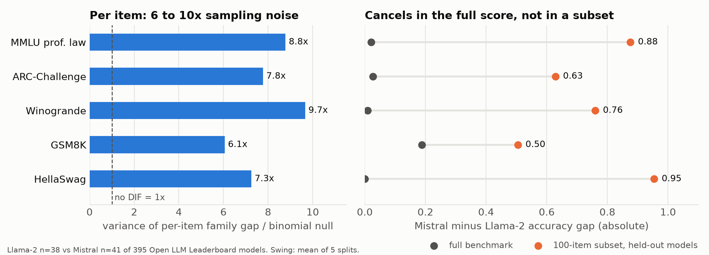

# benchdif

Benchmark items behave differently for different model families. Across 395 Open LLM Leaderboard models the effect runs 6 to 10 times sampling noise per item, cancels almost exactly in the full score, and comes back in full when you score a 100-item subset.

Part of [benchmeasure](https://github.com/abhaymettu/benchmeasure), benchmarks treated as measurement instruments: reliability ([agent-validity-ceiling](https://github.com/abhaymettu/agent-validity-ceiling)), invariance (this repo), and the scorer ([judge-reliability](https://github.com/abhaymettu/judge-reliability)). Paper: [benchmeasure.pdf](https://github.com/abhaymettu/benchmeasure/blob/main/paper/benchmeasure.pdf).



benchdif is a Python library for differential item functioning (DIF) and measurement invariance on AI benchmarks. A model is a test taker, a question is an item, and the group is a model family, a harness or a reasoning-effort setting. It asks whether a question is easier for one group at equal overall ability. Write-up: [abhaymettu.com/research/benchdif](https://abhaymettu.com/research/benchdif/).

## Install

```bash
pip install git+https://github.com/abhaymettu/benchdif
```

Runtime dependencies are numpy, scipy and pandas.

## Quick start

```bash
git clone https://github.com/abhaymettu/benchdif && cd benchdif
uv run python examples/contamination_demo.py
```

This simulates two model families with one leaked question. Accuracy hides the leak (0.4917 vs 0.4877) and Mantel-Haenszel finds it:

```
Leaked item was q13.
  MH:       chi2=33.3  ETS=C
  logistic: chi2=37.9  JG=C
```

In your own code:

```python
from benchdif import detect, logistic, paired_dif, invariance

# responses: (models x items) 0/1 matrix; group: 0 = reference, 1 = focal
detect(responses, group, method="logistic")   # 'mh' | 'logistic' | 'irt', one row per item
invariance(responses, group)                  # configural -> metric -> scalar ladder
```

`examples/quickstart.py` calls every public function once on a simulated benchmark.

## The result

Data: per-item correctness for 395 Open LLM Leaderboard models from the tinyBenchmarks release (Polo et al. 2024, MIT, ungated). Groups are base architectures parsed from model names: Llama-2 (38 models) and Mistral (41).

| benchmark | items | variance over binomial null | full-benchmark gap | 100-item subset, held-out swing |
|---|---:|---:|---:|---:|
| MMLU professional_law | 1534 | 8.8x | +0.0216 | 0.876 |
| ARC-Challenge | 1172 | 7.8x | +0.0272 | 0.629 |
| Winogrande | 1267 | 9.7x | +0.0090 | 0.760 |
| GSM8K | 1319 | 6.1x | +0.1885 | 0.505 |
| HellaSwag | 10042 | 7.3x | +0.0005 | 0.954 |

What the table says:

1. **Per item, DIF is large.** 83 to 90% of the variance in per-item family gaps is item-specific rather than sampling noise. On professional_law, logistic-regression DIF with BH-FDR flags 571 of 1534 items. Permuting family labels at the lineage level (so finetunes of one base model move together) flags a median of 2.
2. **In the full score, it cancels.** Of those 571 items, 278 favour Mistral and 293 favour Llama-2. Dropping all of them moves the family gap from +0.0216 to +0.0221 and changes 1 of the top 10 models.
3. **In a subset, it does not.** Choose 100 items on half the models, score the family gap on the other half, and the gap swings by 0.5 to 0.95 against true gaps of 0.0005 to 0.19. Even random 100-item subsets flip which family looks ahead in 65 of 400 draws. Subset methods (tinyBenchmarks, adaptive testing, "lite" splits) assume items are exchangeable across models, and here they are not.

Reproduce (the download is about 90 MB):

```bash
uv run python data/fetch_leaderboard.py                              # -> data/lb.pickle
uv run python validation/subsample_honest.py data/lb.pickle          # variance ratio, held-out swing
uv run python validation/subsample_honest.py data/lb.pickle harness_gsm8k_5   # other benchmarks by key
uv run python validation/robustness_real_data.py data/lb.pickle      # lineage permutation, replication, rank impact
uv run python validation/subsample_risk.py data/lb.pickle            # 278 vs 293, random-subset sign flips
uv run python validation/dependency_diagnostic.py data/lb.pickle     # model dependence, effective n
uv run --with matplotlib python figures/make_hero.py data/lb.pickle  # the figure above
```

Benchmark keys for the other rows: `harness_arc_challenge_25`, `harness_winogrande_5`, `harness_hellaswag_10`. Full write-up with robustness checks: [FINDINGS.md](FINDINGS.md).

## How it works

| method | what it tests | checked against |
|---|---|---|
| `mantel_haenszel` | uniform DIF, score-stratified, with ETS A/B/C classes and purification | statsmodels CMH, machine precision |
| `logistic` | uniform and non-uniform DIF by nested GLMs | statsmodels GLM, machine precision |
| `generalized_mantel_haenszel` | DIF across more than two groups | statsmodels CMH and simulation |
| `irt_lr` | IRT likelihood-ratio DIF with a purified anchor, so group impact is not read as DIF | power and size simulation |
| `invariance` | configural, metric and scalar invariance on a multi-group 2PL | power and size simulation |
| `paired_dif`, `paired_dtf` | one model under two harnesses or effort settings, conditional on each (model, item) stratum | statsmodels ConditionalLogit (2.2e-16), simulation |

The 2PL backend is a hand-written Bock-Aitkin MML-EM, validated by parameter recovery. `check_adequacy()` warns when a matrix is too wide for a method: with 79 models over about 1500 score levels, Mantel-Haenszel strata are nearly empty and it returns 0 everywhere, so the leaderboard result uses logistic regression.

`paired_dif` exists for the harness question: does an agent harness or effort setting change which items a model solves, or only how many? Conditioning on each item's total successes removes everything the two conditions share for that model and item. It is validated and power-analysed at the design sizes of the AIMS measurement-db ([FINDINGS-harness.md](FINDINGS-harness.md)); the real-data run is waiting on access to that gated dataset.

## What is new here

The closest work is Zheng and Yang (2026, arXiv 2609.00482). They estimate residual DIF across model families with a spectral approximation to multidimensional IRT on MMLU-Pro, BBH, MMLU, HellaSwag and WinoGrande, and find aggregate rankings robust while near-tied cross-family pairs reverse. That is the same qualitative pattern as sections 1 and 2 above, reached by a different method. tinyBenchmarks (Polo et al. 2024) is the subset method whose exchangeability assumption section 3 tests, and the source of the data.

What benchdif adds:

- classical Mantel-Haenszel and logistic-regression DIF as a library, matched to statsmodels at machine precision rather than approximated;
- the framing that DIF cancels at the test level, measured as a count of items favouring each side and a rank-impact check;
- the held-out subset swing: items chosen on one half of the models and scored on the other, so the subset result is not circular;
- the paired harness/effort design, which tests one model against itself and needs no ability model.

## Limits

- **Not contamination.** DIF is a symptom. Tokenizers, prompt-format sensitivity, instruction-tuning style and training mix all produce it, and attribution needs separate evidence.
- **Single item flags are noisy.** Items flagged on half the models also flag on the held-out half about 40% of the time (base rate 13 to 22%). The aggregate effect is solid; "item 466 has DIF" is not a reliable claim.
- **Era-bound.** These are 2023-24 leaderboard models. Current frontier models are untested.
- **Families are labelled from model names**, and finetunes share lineage. Single-linkage clustering finds 36 lineages among 38 Llama-2 models and 38 among 41 Mistral, so effective n is close to nominal, but the labels are heuristic.
- **The harness result is pending.** No real-data claim is made about harnesses. At most design sizes only DIF of about 2 logits on 10% of items is detectable, and a null there says little.

## Files

```
src/benchdif/        dif/ (MH, logistic, IRT-LR, generalized MH, paired), irt/ (2PL, invariance), adapters, detect
validation/          oracle checks and simulations for every method, plus the real-data scripts
examples/            quickstart, contamination demo, harness DIF on measurement-db tables
figures/             make_hero.py and hero.png
FINDINGS.md          leaderboard result and robustness checks
FINDINGS-harness.md  harness/effort design, power at real design sizes
DECISIONS.md         analysis choices as they were made
```

Tests: `uv run pytest -q` (46 tests). Notes for coding agents are in [AGENTS.md](AGENTS.md).

## Cite

MIT licensed. To cite:

```bibtex
@software{mettu2026benchdif,
  author = {Mettu, Abhay},
  title  = {benchdif: Differential Item Functioning and Measurement Invariance for AI Benchmarks},
  year   = {2026},
  url    = {https://github.com/abhaymettu/benchdif}
}
```
